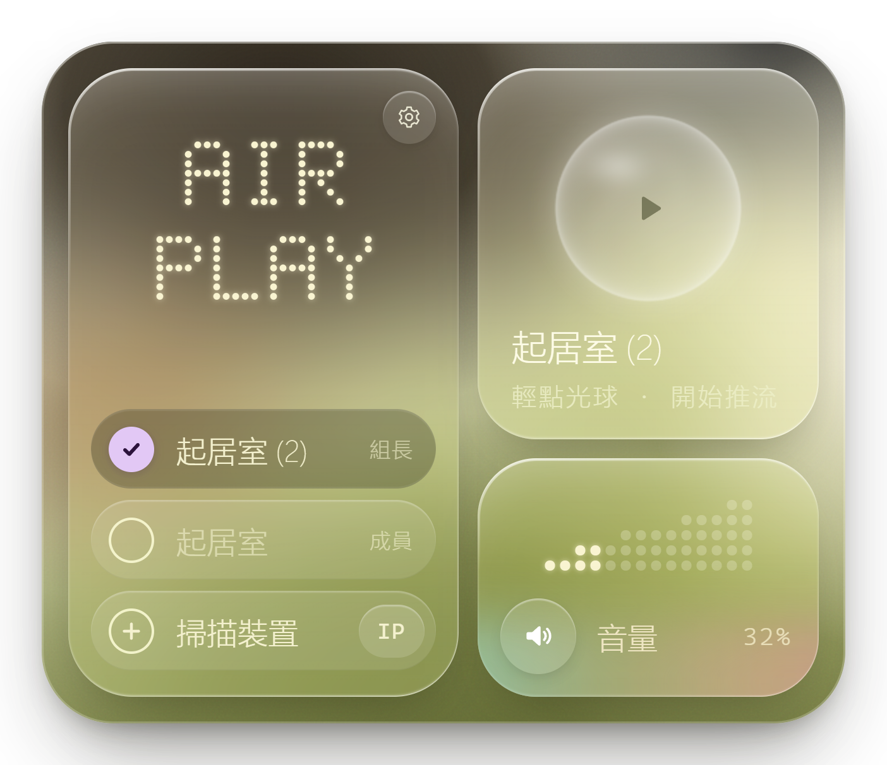
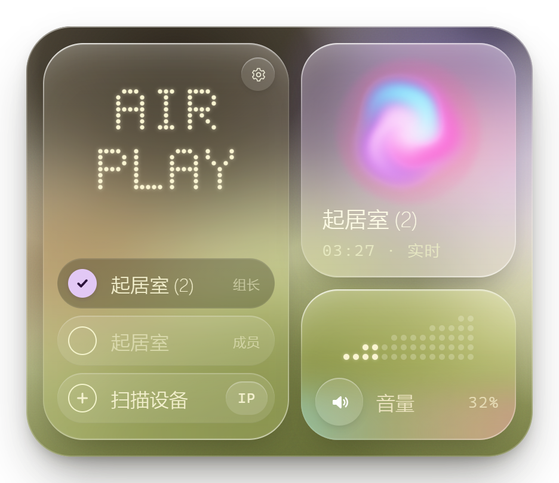
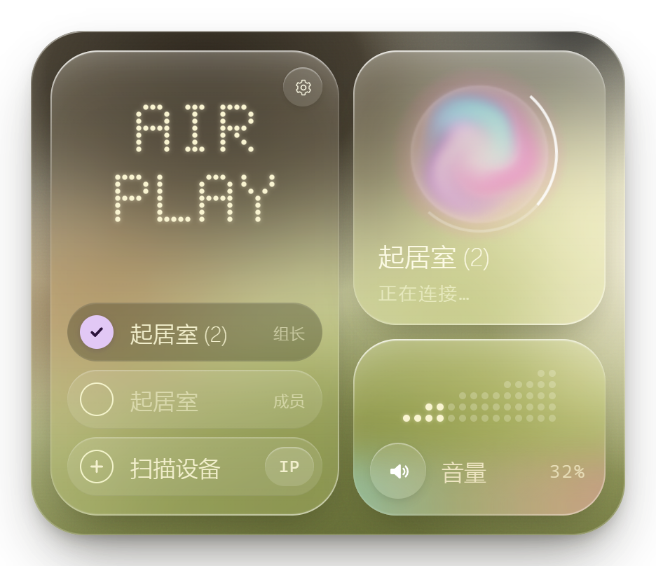
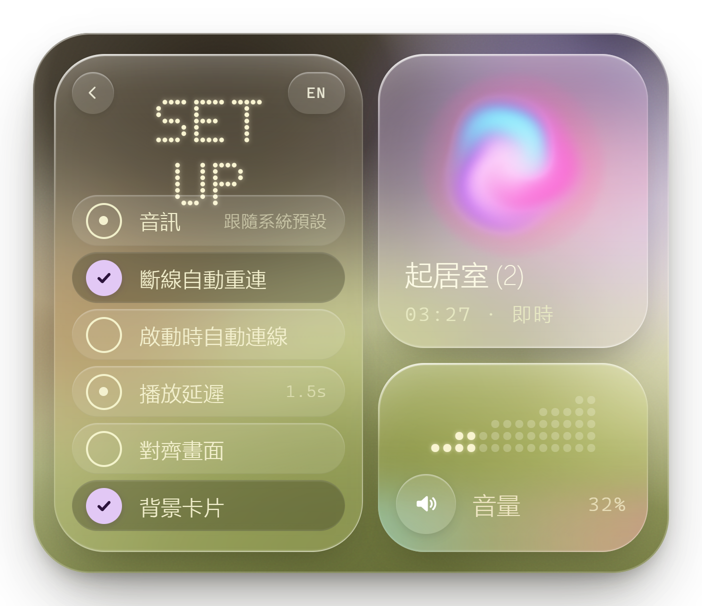
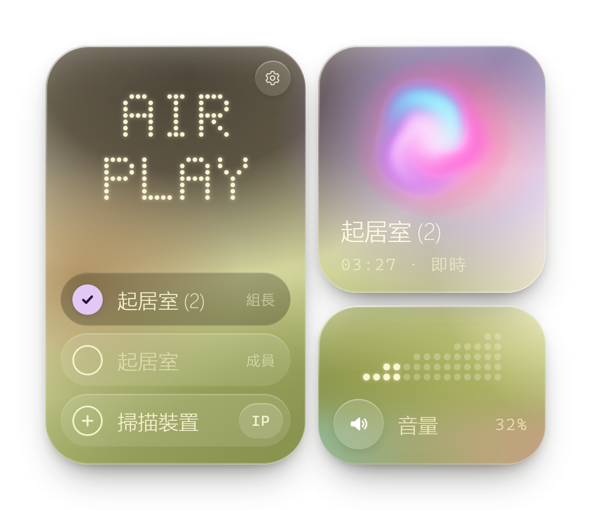

# HomePod 推流

把电脑正在播放的声音，实时推送到 HomePod（AirPlay 2）。用来替代在 HomePod 系统 27.0 上已经出不了声的 TuneBlade。

界面复刻参考图里的**磨砂玻璃小组件**：三张半透明玻璃卡片叠在柔焦背景上，配点阵大字、胶囊勾选行和彩虹渐变。
程序常驻在**任务栏右下角**：启动时屏幕中央浮现一团 **Siri 光团**，它沿弧线飞到右下角，面板再从光团所在位置绽开。
托盘图标也是这颗光球：未播放时是透明白色球体，推流时变成随音量滚动的彩色光团。应用图标（开始菜单、安装包）同样是这团光。

前端是 **Tauri 2 + React 19 + Vite 7**；Rust 外壳负责窗口、托盘、单实例与 sidecar 进程。AirPlay 协议、WASAPI 回环抓取与重采样仍由原来的 C#（`Ap2Core`）负责，通过 `Sidecar` 进程以 NDJSON over stdio 暴露给界面，协议和音频链路没有重写。

> **下载**：[Releases](https://github.com/YFPS/HomePodSender/releases) —— 安装包（当前用户，无需管理员）或免安装 zip。
> 需要 Windows 10/11 x64、WebView2 运行时和 .NET 8 桌面运行时；从源码构建见下文。

| 未播放 | 推流中 |
|---|---|
|  |  |

| 连接中 | 设置（卡片翻面） |
|---|---|
|  |  |

| 关闭背景卡片（三张卡各自悬浮） |
|---|
|  |

| 启动动画：浮现 | 停顿 | 飞向右下角 |
|---|---|---|
|  |  |  |

## 怎么用

1. 从 [Releases](https://github.com/YFPS/HomePodSender/releases) 下 `HomePodSender_*_x64-setup.exe` 安装（当前用户，无需管理员），或解压免安装 zip 后直接运行 `HomePodSender\HomePodSender.exe`（需保留旁边的 `sidecar\HomePodSidecar.exe`）。
2. 从开始菜单启动 HomePodSender。屏幕中央先出现光团，约 2 秒后飞到右下角，面板在任务栏上方展开。
3. **左边高卡（AirPlay）**：点设备行选择要推流的 HomePod；「扫描设备」搜索局域网，「IP」手动添加。
4. **右上卡（光球）**：轻点光球开始推流，再点一下断开。卡片下方显示设备名和推流时长。
5. **右下卡（音量）**：点或拖动点阵调 **HomePod 的音量**，鼠标滚轮每格 ±2%，左边喇叭键一键静音 / 恢复。
6. 点面板以外的地方或按 Esc，面板收回；**左键点托盘光球**可以再次打开或收起。右键托盘图标可连接、断开、打开日志文件夹或退出。
7. 再次从开始菜单启动程序，不会开第二个实例，只会把面板唤出来。

> Windows 11 默认把新程序的托盘图标收进任务栏的「^」溢出区。想让光球一直显示在任务栏上：
> 设置 → 个性化 → 任务栏 → 其他系统托盘图标 → 打开 HomePodSender。

需要 Windows 10/11 x64、WebView2 运行时（Windows 11 自带，Win10 一般也已安装）和 .NET 8 桌面运行时（sidecar 使用）。

## 立体声对（两台 HomePod 一起出声）

你的两台是 Home 里的**立体声对**，正常时只需要连接**组长**（`起居室 (2)`，192.168.50.71），HomePod 自己会把左右声道分给两台。
不需要、也不应该同时连两台，也不要直连成员。设备列表里标出「组长 / 成员」，点到成员时程序会自动改连组长。

每次选择设备、点光球连接、启动时自动连接之前，以及运行期间每 30 秒，程序都会现场读一次两台的 `/info`（只读，不出声），按 HomePod 当前的报告判断是否成对。
如果两台都报告自己是组长，说明此刻**没有建立起立体声分组**：列表里两台都显示「组长」，播放卡片显示「未组立体声对」（推流时显示「仅此一台」）。
2026-10-20 实测：**直连成员那台会让分组散掉**（两台又都报告组长）。所以程序只在**确认成对**时把成员改连组长；
两台都自称组长（未成对）时按你点的设备连接，并提示「未组立体声对」，方便单独使用那一台。程序不会替它们猜谁是组长。

修复要在 Home（家庭）App 里做，程序无法代劳：确认两台是否仍在同一个立体声对里；已经拆开就重新创建；还在的话，可以先给成员那台断电重插，
等一两分钟再用 `probe --txt` 看它是否重新报告为成员（带 `pgid`）。

## 设置（左卡右上角齿轮，卡片翻到背面）

| 项 | 说明 |
|---|---|
| 断线自动重连 | 网络闪断或 HomePod 重启后自动重连 |
| 启动时自动连接 | 默认关闭，避免一开机就出声 |
| 播放延迟 | 点一下在 0.5 / 1 / 1.5 / 2 秒间切换。越大越抗网络抖动；看视频请选小一点。下次连接生效 |
| 背景卡片 | 默认开启：三张卡片衬在一块圆角背景卡片上。关掉后背景卡片消失，三张卡片各自悬浮在桌面上（磨砂质感保留） |

左上角的返回键翻回设备列表。

## 安全默认值

- 不会自动连接、不会自动出声；首次默认音量 20%。
- 连接时先把音量设好，再开始推流，不会以 HomePod 上次的音量突然出声。
- 配置与日志在 `%APPDATA%\HomePodSender\`（`config.json`、`log.txt`），新旧版本共用。

## 技术结构

| 路径 | 说明 |
|---|---|
| `Desktop\src\Panel.jsx` | 右下角面板：三张玻璃卡、设备 / 设置翻面、音量点阵、开合动画 |
| `Desktop\src\Intro.jsx` | 启动动画（全屏透明、鼠标穿透窗口）：光团浮现 → 停顿 → 弧线飞到面板光球位置 |
| `Desktop\src\Orb.jsx` | Siri 光团 WebGL 着色器：彩色光团（推流）/ 透明白球（未播放）连续过渡，亮度和旋转跟随实时电平 |
| `Desktop\src\DotText.jsx` | 5×7 点阵字（SVG 圆点，不依赖外部字体） |
| `Desktop\src\layout.js` | 面板几何（与 Rust 常量一致）和截图预览参数 |
| `Desktop\src-tauri\src\main.rs` | Tauri 外壳：面板 / 启动动画两个透明窗口、托盘、单实例、sidecar 与 NDJSON 桥 |
| `Desktop\src-tauri\src\orb.rs` | 托盘光球：与着色器同一套公式，在 CPU 上逐帧绘制，窗口隐藏时也能动 |
| `Desktop\scripts\` | 开发脚本：端到端测试、WebView2 截图、桌面连拍、托盘实拍 |
| `Desktop\src-tauri\target\release\bundle\nsis\` | 打包好的安装程序 |
| `Sidecar\` | C# 宿主进程：stdin/stdout NDJSON，把 `Ap2Core` 暴露给界面 |
| `Ap2Core\` | AirPlay 协议、音频、连接控制器（与界面无关） |
| `Ap2Cli\` | 命令行工具与测试（含本机“假 HomePod”） |
| `App\` | 旧的 WPF 界面（保留作对照与回退） |
| `design-ref\` | 参考设计图与对比、托盘图标预览脚本 |
| `shots\` | 新界面截图（面板 2x，透明底） |

## 实现要点

- 玻璃：`backdrop-filter: blur() saturate() brightness()` 加多层内描边高光和渐变描边；面板自带一层柔焦背景（几团径向渐变加颗粒），桌面是什么颜色都有东西可“透”。
- Siri 光团：五团彩光（品红 / 蓝 / 紫 / 青 / 暖橙）在漩涡坐标里游走、叠加发光，中心白热、边缘随声音起伏，按“发光”输出预乘透明度，叠在任何桌面上都自然。
  时间统一取墙钟，所以启动动画窗口、面板和托盘里的光团花纹同相。
- 启动交接：动画开始飞行时 Rust 先把面板窗口以全透明待命态显示出来，落地瞬间面板光球接替动画光球，板以圆形 `clip-path` 从光球中心绽开，动画窗口随后关闭，中间没有空档。
- 面板窗口：无边框、透明、置顶、不进任务栏，贴住主显示器工作区右下角；失焦或 Esc 时先播收起动画再隐藏。
- 桥接：Rust 用 `std::process` 启动 sidecar，stdout 逐行解析 JSON；界面通过 `invoke('sidecar_call')` 发命令，
  通过 `listen('sidecar:event')` 收状态、20 Hz 电平和扫描进度。不开任何端口。
- AirPlay 2 实时流：HAP 瞬时配对（SRP-6a 3072 / SHA-512）→ ChaCha20-Poly1305 加密 RTSP → NTP 授时 →
  未压缩 ALAC + ChaCha20 的 RTP 音频，每秒同步包，丢包重传，2 秒一次心跳。
- 系统声音：WASAPI 回环抓取默认播放设备（跟随默认设备切换），96 抽头 Kaiser 窗 sinc 重采样到 44.1kHz，
  带漂移补偿；系统无声时自动补静音。
- 设备发现不依赖多播 mDNS：扫描本机网段的 TCP 7000，读取 `/info`。立体声对角色看 TXT 的 `tsid`（同一对相同）、
  `igl`（自称组长）和 `pgid`（隶属上级分组）。同一对按整组裁决（`Discovery.ResolvePairs`）：一台自称组长且无 `pgid`、另一台自称成员且带 `pgid` 时才算成对，
  否则两台都标为「未成对」并保留各自的报告，不替它们猜角色。
- 成对时把组长记进 `PairLeaders`（`config.json`）；点成员时优先连现场确认的组长，现场探不到组长时用记住的组长。
  两台都自称组长（未成对）时按所选设备连接，不强制改目标——此时本来就没有可保护的分组。每 30 秒重读一次角色，跟随播放 / 空闲状态变化并刷新界面。

## 开发与测试（都不联网、不出声）

需要 Rust 1.77+、.NET 8 SDK、Node 20+。

```powershell
cd Desktop
npm install

# 开发：tauri dev（自动构建 sidecar、启动 Vite、编译并打开应用）
npm run dev

# 只看界面：浏览器打开 http://127.0.0.1:5173/?preview=streaming （还有 idle / connecting / failed，&page=settings 翻面，
# ?view=intro&preview=1&t=1.0 看启动动画某一帧，?view=orbtest&bg=dark 看各状态光团）
npm run dev:web

# 打包 NSIS 安装程序
npm run pack

# 端到端测试：本机假 HomePod + 真实 Tauri 应用，WebView2 CDP 驱动（启动交接、面板位置、连接 / 音量 / 设置 / 收起 / 单实例 / 退出）
npm run e2e
# 加 --shots 同时连拍桌面右下区域，核对真实桌面上的动画（输出 Desktop\shots\live\）
node scripts/e2e.mjs --shots

# 渲染 6 个面板状态（含关闭背景卡片）+ 3 帧启动动画到 ..\shots
npm run shots

# 立体声对实机检查：只读探测两台 /info，按实际报告检查选择成员时的行为（成对改连组长，未成对保持所选，均不连接、不出声）
node scripts/pair-check.mjs 192.168.1.71 192.168.1.23
```

已安装的 HomePodSender 正在运行时，端到端测试会自动用隔离模式（环境变量 `HPS_ISOLATED=1`：不注册单实例、WebView2 用单独的数据目录），
不会去唤出你正在用的那个程序，此时跳过两项单实例检查；截图模式总是隔离。

截图和测试脚本会自动拉起 Vite；Tauri 的 debug 构建从 `http://127.0.0.1:5173` 加载界面。
改过 Rust 外壳后需要 `cargo build --manifest-path src-tauri/Cargo.toml`（或跑一次 `npm run dev`）。
调试版启动参数：`--tray` 不播启动动画、直接收在托盘；`--dump-tray <目录>` 导出托盘图标帧（配合 `design-ref\compose_tray.py` 预览）；
`--dump-app-icons <目录>` 导出应用图标帧，再用 `design-ref\make_app_icons.py <目录> src-tauri\icons` 生成 exe / 安装包图标（同一颗光团）。
环境变量 `HPS_KEEP_PANEL=1` 让面板失焦时不自动收起（自动化测试用）。

核心协议自测（不需要界面）：

```powershell
dotnet build Ap2Cli\Ap2Cli.csproj
dotnet Ap2Cli\bin\Debug\net8.0-windows\Ap2Cli.dll selftest          # 加密/编码/时间换算自测
dotnet Ap2Cli\bin\Debug\net8.0-windows\Ap2Cli.dll e2e-test          # 与本机假 HomePod 端到端
dotnet Ap2Cli\bin\Debug\net8.0-windows\Ap2Cli.dll controller-test   # 连接/音量/重连/断开
dotnet Ap2Cli\bin\Debug\net8.0-windows\Ap2Cli.dll probe <IP> [<IP>…] [--txt]   # 只读读取 /info 与立体声对角色，--txt 显示 igl / gid / pgid
```

`Ap2Cli run --ip <IP>` 会真的连接 HomePod，默认推静音；必须显式加 `--sound` 才发声。

## 开源、许可与免责

本项目以 **MIT 许可**开源，见 [LICENSE](LICENSE)。

- 单文件桌面应用，全部源码在本仓库：C# 协议与音频（`Ap2Core`）、sidecar 进程（`Sidecar`）、Tauri 外壳（`Desktop/src-tauri`）、React 界面（`Desktop/src`）、命令行诊断（`Ap2Cli`）。
- 仓库里不含任何配对密钥、账号信息或你的设备配置：配对凭证运行时才生成，配置文件落在 `%APPDATA%\HomePodSender\config.json`。
- 欢迎 issue / PR。改动协议或音频链路时请先跑 `Ap2Cli selftest` 与 `npm run e2e`（都是本机假 HomePod，不联网、不出声）。

**免责声明**：本项目与 Apple Inc. 无任何关联，也未获其授权或认可。AirPlay、AirPlay 2、HomePod、Apple 为 Apple Inc. 的商标。
这里的 AirPlay 2 实现来自对公开协议行为的独立实现，仅供个人在自己的设备上使用；请自行确认在你所在地区的合法性，作者不对使用后果承担责任。

## 已知限制

- 延迟 0.5–2 秒，不适合对口型的视频；音乐没问题。
- 回环抓取的是“默认播放设备”的混音：电脑本机也会同时播放（耳机/音箱），不想听可在系统里把输出设备静音或调低。
- 一次只连一个目标（立体声对算一个）；非立体声对的多房间同步播放暂未做。
- 两台 HomePod 没有配成立体声对时，程序只能从所选的那一台出声；这由 Home App 里的立体声对状态决定，需要在那边修好。
- 面板固定出现在**主显示器**右下角（任务栏在底部时）；任务栏放在侧边或顶部时位置会贴工作区右下角，但不一定靠着托盘。
- Windows 防火墙开启时，首次运行可能弹出“允许访问”提示，需要允许专用网络（HomePod 要回送授时和重传包）。
- 安装包未签名，首次运行 SmartScreen 可能提示；WebView2 缺失的 Windows 10 需要先安装运行时。
