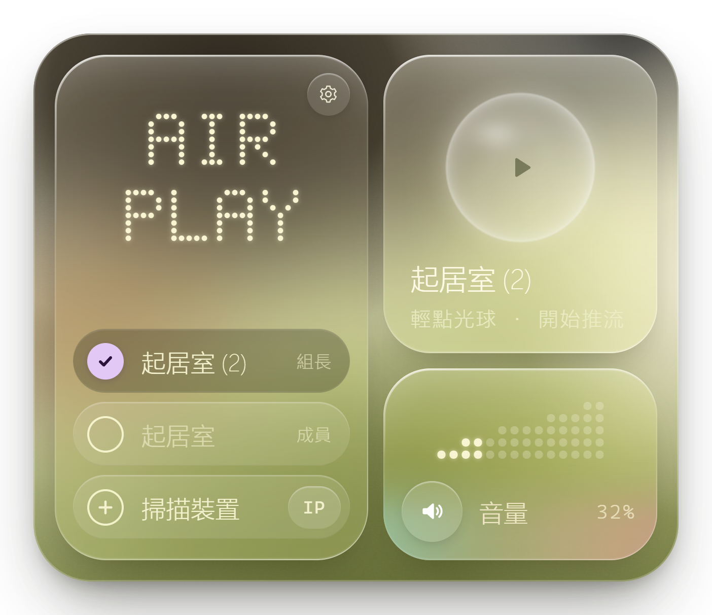
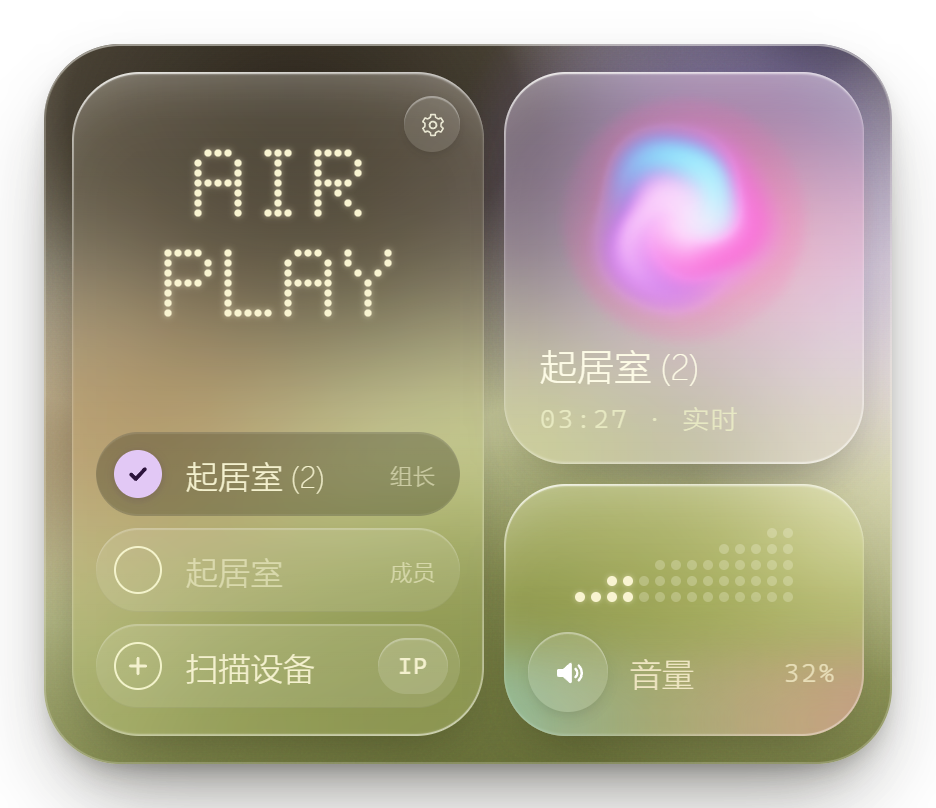
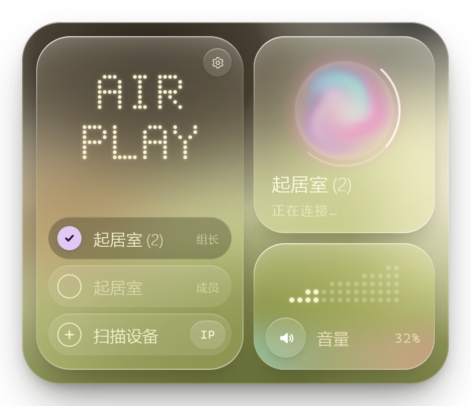
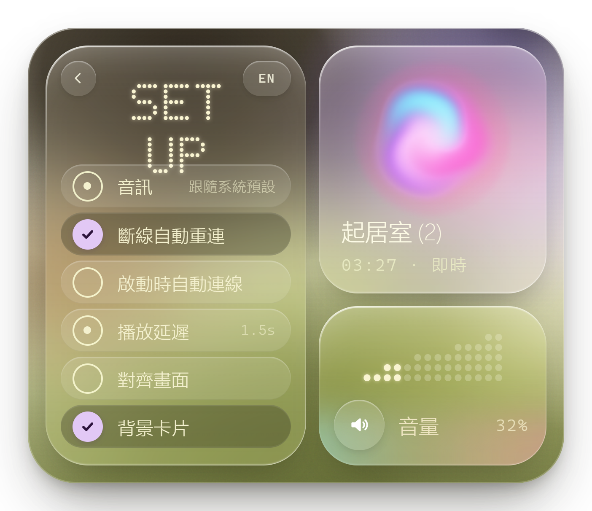
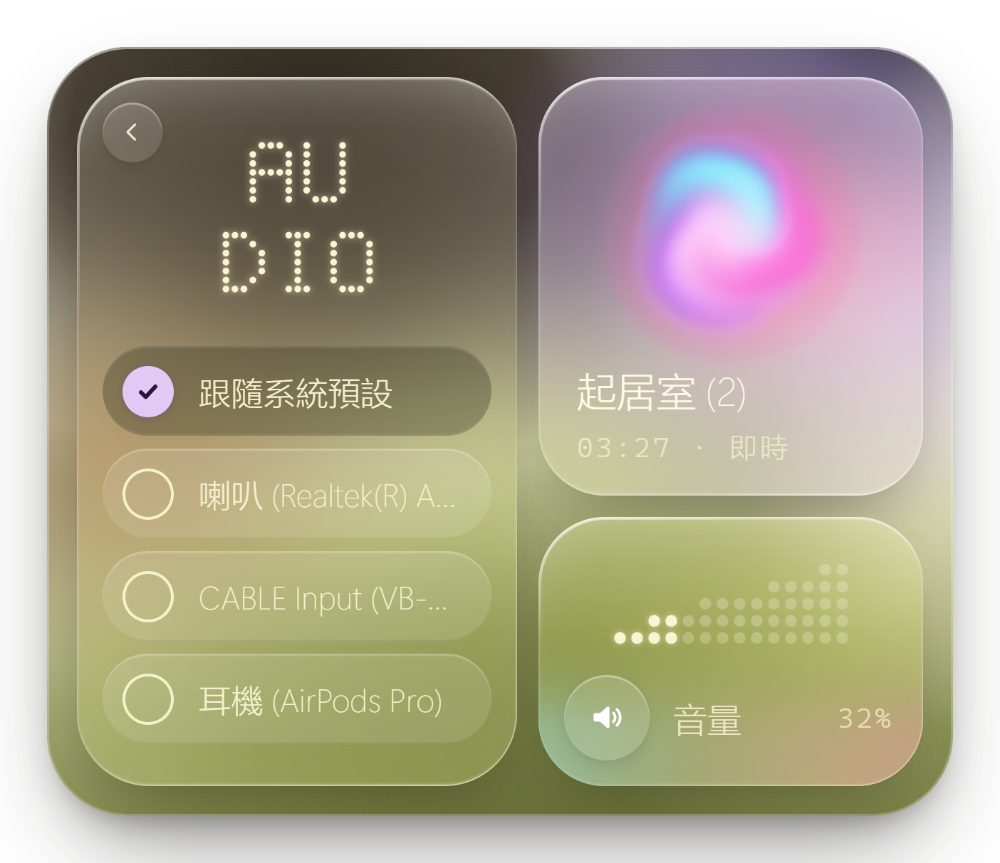
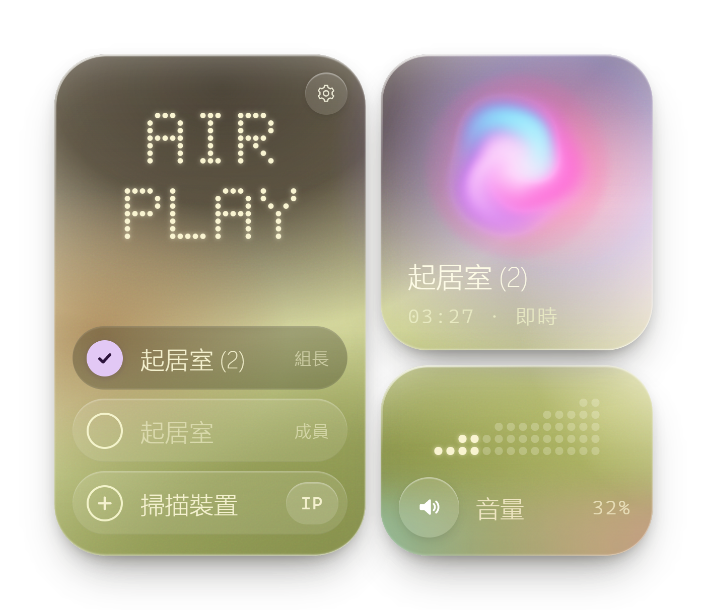

# HomePod 推流

將電腦正在播放的聲音，透過 AirPlay 2 即時推送到 HomePod，用來替代在 HomePod 系統 27.0 上已無法出聲的 TuneBlade。

介面採用**毛玻璃小工具**風格：三張半透明玻璃卡片疊在柔焦背景上，搭配點陣大字、膠囊勾選列與彩虹漸層。
程式常駐於**工作列右下角**：啟動時螢幕中央浮現一團 **Siri 光團**，沿弧線飛往右下角，面板再從光團所在位置綻開。
系統匣圖示也是這顆光球：未播放時為透明白色球體，推流時會變成隨音量起伏流動的彩色光團；開始功能表與安裝程式的應用程式圖示同樣採用這顆光球。

前端使用 **Tauri 2 + React 19 + Vite 7**；Rust 外殼負責視窗、系統匣、單實例與 sidecar 行程管理。AirPlay 2 協定、WASAPI 回環擷取與重取樣由 C#（`Ap2Core`）實作，並透過 `Sidecar` 行程以 NDJSON over stdio 與介面通訊。

> **下載**：[Releases](https://github.com/Miku0139oao/HomePodSender/releases) —— 提供安裝程式（僅安裝給目前使用者，無需系統管理員權限）或免安裝版 zip。
> 需要 Windows 10/11 x64、WebView2 執行環境與 .NET 8 桌面執行環境；從原始碼建置請見下方說明。

| 未播放 | 推流中 |
|---|---|
|  |  |

| 連線中 | 設定（卡片翻面） |
|---|---|
|  |  |

| 音訊來源（可選擇音效卡） |
|---|
|  |

| 關閉背景卡片（三張卡片各自懸浮） |
|---|
|  |

| 啟動動畫：浮現 | 停頓 | 飛向右下角 |
|---|---|---|
|  |  |  |

## 使用方式

1. 從 [Releases](https://github.com/Miku0139oao/HomePodSender/releases) 下載 `HomePodSender_*_x64-setup.exe` 安裝（無需管理員權限），或解壓縮免安裝 zip 後直接執行 `HomePodSender\HomePodSender.exe`（需保留同目錄下的 `sidecar\HomePodSidecar.exe`）。
2. 從開始功能表啟動 HomePodSender。螢幕中央會先浮現光團，約 2 秒後飛往右下角，面板於工作列上方展開。
3. **左側高卡（AirPlay）**：點選裝置列選擇要推流的 HomePod；按「掃描裝置」搜尋區域網路，或按「IP」手動新增。
4. **右上卡（光球）**：輕點光球開始推流，再點一次中斷連線；卡片下方會顯示裝置名稱與推流時間。
5. **右下卡（音量）**：點擊或拖曳點陣調整 **HomePod 音量**，滑鼠滾輪每格 ±2%，左側喇叭鍵可一鍵靜音 / 恢復。
6. 設定頁右上角可切換 **繁體中文 / English**，偏好設定會儲存在本機。
7. 點擊面板以外區域或按 `Esc` 可收合面板；**左鍵點擊系統匣光球**可再次開啟或收合，右鍵可連線、中斷連線、開啟日誌資料夾或結束程式。
8. 再次從開始功能表啟動程式時，不會開啟第二個實例，而是直接喚出面板。

> Windows 11 預設會將新程式的系統匣圖示收進工作列的「^」溢位區。若想讓光球常駐顯示在工作列上：
> 設定 → 個人化 → 工作列 → 其他系統匣圖示 → 開啟 HomePodSender。

系統需求：Windows 10/11 x64、WebView2 執行環境（Windows 11 已內建，Windows 10 多數亦已安裝）以及 .NET 8 桌面執行環境（供 sidecar 使用）。

## 立體聲對（兩台 HomePod 同時出聲）

若你的兩台 HomePod 已在 Apple「家庭（Home）」App 中組成**立體聲對**，正常情況下只需連線**組長**，HomePod 會自行將左右聲道分配給兩台喇叭。
不需要、也不應該同時連線兩台，更不要直連成員。裝置清單會標示「組長 / 成員」，點選成員時程式會自動改連組長。

每次選擇裝置、點光球連線、啟動自動連線前，以及執行期間每 30 秒，程式都會即時讀取兩台的 `/info`（唯讀，不會出聲），依 HomePod 當下的回報判斷是否已成對。
如果兩台都回報自己是組長，代表此刻**並未建立立體聲群組**：清單中兩台都會顯示「組長」，播放卡片會提示「未組成同一組立體聲對」（推流時顯示「僅此一台」）。
實測直連成員會導致群組分散（兩台皆回報組長），因此程式僅在**確認成對**時將成員改連組長；
兩台都自稱組長（未成對）時會依你點選的裝置連線並給出提示，不會替它們猜測誰是組長。

立體聲群組的修復需在「家庭（Home）」App 內處理，程式無法代勞：確認兩台是否仍在同一組立體聲對中；若已拆散請重新建立；若仍在群組內，可先將成員斷電重插，等一兩分鐘後再用 `probe --txt` 檢查是否重新回報為成員（帶 `pgid`）。

## 設定（左卡右上角齒輪，卡片翻至背面）

| 項目 | 說明 |
|---|---|
| 音訊 | 跟隨 Windows 預設播放裝置，或固定擷取指定的播放端點（音效卡 / 虛擬音效卡）。播放中切換會自動重新連線 |
| 斷線自動重連 | 網路閃斷或 HomePod 重新啟動後自動嘗試重新連線 |
| 啟動時自動連線 | 預設關閉，避免一開啟程式就突然出聲 |
| 播放延遲 | 點一下在 0 / 0.1 / 0.25 / 0.5 / 1 / 1.5 / 2 秒間循環切換。延遲越低越跟手，但也越容易受網路抖動影響；0 秒為實驗值，下次連線生效 |
| 對齊畫面 | 搭配內建的 Chrome 擴充功能，僅延後網頁畫面以對齊 HomePod 播放延遲（聲音仍即時送出） |
| 背景卡片 | 預設開啟：三張卡片襯在一塊圓角背景卡片上；關閉後三張卡片各自懸浮於桌面（保留毛玻璃質感） |

點擊左上角的返回鍵即可翻回裝置清單。

## 安全預設值

- 預設不自動連線、不自動出聲；首次啟動預設音量為 20%。
- 連線時會先設定好音量再開始推流，避免以 HomePod 上次的音量突然大聲播放。
- 組態檔與日誌儲存在 `%APPDATA%\HomePodSender\`（`config.json`、`log.txt`）。

## 技術架構

| 路徑 | 說明 |
|---|---|
| `Desktop\src\Panel.jsx` | 右下角面板：三張玻璃卡、裝置 / 設定翻面、音量點陣、開合動畫 |
| `Desktop\src\Intro.jsx` | 啟動動畫（全螢幕透明、滑鼠穿透視窗）：光團浮現 → 停頓 → 弧線飛往面板光球位置 |
| `Desktop\src\Orb.jsx` | Siri 光團 WebGL 著色器：彩色光團（推流）/ 透明白球（未播放）連續過渡，亮度與旋轉跟隨即時電平 |
| `Desktop\src\DotText.jsx` | 5×7 點陣字（SVG 圓點，不依賴外部字型） |
| `Desktop\src\layout.js` | 面板幾何參數（與 Rust 常數一致）與截圖預覽參數 |
| `Desktop\src-tauri\src\main.rs` | Tauri 外殼：面板 / 啟動動畫兩個透明視窗、系統匣、單實例、sidecar 與 NDJSON 橋接 |
| `Desktop\src-tauri\src\orb.rs` | 系統匣光球：與著色器同一套公式，在 CPU 上逐幀繪製，視窗隱藏時仍可動態顯示 |
| `Desktop\lipsync\extension\` | Chrome 畫面對齊擴充功能（隔離世界執行，不向網頁主世界注入腳本） |
| `Desktop\scripts\` | 開發與測試腳本：端對端測試、WebView2 截圖、桌面連拍、系統匣實拍 |
| `Desktop\src-tauri\target\release\bundle\nsis\` | 打包完成的 NSIS 安裝程式 |
| `Sidecar\` | C# 宿主行程：透過 stdin/stdout NDJSON 將 `Ap2Core` 暴露給介面 |
| `Ap2Core\` | AirPlay 2 協定、音訊、連線控制器與畫面對齊服務（與介面無關） |
| `Ap2Cli\` | 命令列診斷工具與測試（含本機「假 HomePod」） |
| `design-ref\` | 參考設計對比與圖示產生腳本 |
| `shots\` | 介面截圖（面板 2x，透明底） |

## 實作要點

- **毛玻璃**：`backdrop-filter: blur() saturate() brightness()` 搭配多層內描邊高光與漸層描邊；面板自帶一層柔焦背景（徑向漸層與雜訊顆粒），無論桌布為何種顏色都能呈現通透感。
- **Siri 光團**：五團彩光（品紅 / 藍 / 紫 / 青 / 暖橘）在漩渦座標中游走並疊加發光，中心白熱、邊緣隨聲音起伏，以預乘透明度輸出，疊在任何桌面上都自然。時間統一取牆鐘，讓啟動動畫、面板與系統匣中的光團花紋同相銜接。
- **啟動交接**：動畫開始飛行時，Rust 會先將面板視窗以全透明待命態顯示出來；落地瞬間面板光球無縫接替動畫光球，面板以圓形 `clip-path` 自光球中心綻開，隨後關閉動畫視窗。
- **面板視窗**：無邊框、透明、置頂、不進工作列，貼齊主螢幕工作區右下角；失焦或按 `Esc` 時先播放收合動畫再隱藏，隱藏期間自動暫停 WebGL 與動畫迴圈以降低背景耗電。
- **橋接與安全**：Rust 以 `std::process` 啟動 sidecar，stdout 逐行解析 JSON；介面透過 `invoke('sidecar_call')` 發送指令，並以 `listen('sidecar:event')` 接收狀態、20 Hz 電平與掃描進度。介面與 sidecar 之間不開啟連接埠；畫面對齊功能僅在 `127.0.0.1:17321` 監聽本機回環 HTTP（驗證 `Host` 標頭、不開放跨站 CORS）供 Chrome 擴充功能背景查詢延遲設定。
- **AirPlay 2 即時串流**：HAP 瞬時配對（SRP-6a 3072 / SHA-512）→ ChaCha20-Poly1305 加密 RTSP → NTP 授時 → 未壓縮 ALAC + ChaCha20 加密 RTP 音訊，每秒同步封包、支援遺失封包重傳、每 2 秒心跳。
- **系統聲音**：WASAPI 回環支援擷取預設播放裝置或指定輸出端點（音效卡 / 虛擬音效卡），以 96 抽頭 Kaiser 窗 sinc 重取樣至 44.1 kHz 並具漂移補償，系統無聲時自動補靜音。
- **裝置探索**：不依賴多播 mDNS，直接掃描本機網段 TCP 7000 並讀取 `/info`。立體聲對角色依據 TXT 的 `tsid`、`igl`（自稱組長）與 `pgid`（隸屬上級群組）按整組裁決（`Discovery.ResolvePairs`）：僅一台自稱組長且無 `pgid`、另一台自稱成員且帶 `pgid` 時才算成對，否則皆標示為「未成對」並保留各自回報。
- **群組記憶**：確認成對時會將組長寫入 `PairLeaders`（`config.json`）；點選成員時優先連線現場確認的組長，現場探不到則使用記錄的組長；每 30 秒重新讀取一次角色以跟隨播放 / 閒置狀態變化。

## 開發與測試（皆不連網、不出聲）

需要 Rust 1.77+、.NET 8 SDK、Node.js 20+。

```powershell
cd Desktop
npm install

# 開發模式：tauri dev（自動建置 sidecar、啟動 Vite、編譯並開啟應用）
npm run dev

# 僅預覽介面：瀏覽器開啟 http://127.0.0.1:5173/?preview=streaming
# （另有 idle / connecting / failed，&page=settings 翻面，&page=audio 看音效卡選擇，
# ?view=intro&preview=1&t=1.0 看啟動動畫特定幀，?view=orbtest&bg=dark 看各狀態光團）
npm run dev:web

# 打包 NSIS 安裝程式
npm run pack

# 端對端測試：本機假 HomePod + 真實 Tauri 應用，WebView2 CDP 驅動
npm run e2e
# 加 --shots 可同時連拍桌面右下區域，核對真實桌面上的動畫（輸出至 Desktop\shots\live\）
node scripts/e2e.mjs --shots

# 渲染 7 個面板狀態（含音效卡選擇、關閉背景卡片）+ 3 幀啟動動畫到 ..\shots
npm run shots

# 立體聲對實機檢查：唯讀探測兩台 /info，確認選擇成員時的行為（不連線、不出聲）
node scripts/pair-check.mjs 192.0.2.10 192.0.2.11
```

若已安裝的 HomePodSender 正在執行，端對端測試會自動進入隔離模式（環境變數 `HPS_ISOLATED=1`：不註冊單實例、WebView2 使用獨立資料目錄），不會影響正在使用的程式，此時會跳過兩項單實例檢查；截圖模式永遠使用隔離模式。

截圖與測試腳本會自動啟動 Vite；Tauri 的 debug 建置由 `http://127.0.0.1:5173` 載入介面。
修改 Rust 外殼後需執行 `cargo build --manifest-path src-tauri/Cargo.toml`（或跑一次 `npm run dev`）。
偵錯版啟動參數：`--tray` 不播啟動動畫、直接收在系統匣；`--dump-tray <目錄>` 匯出系統匣圖示幀（搭配 `design-ref\compose_tray.py` 預覽）；
`--dump-app-icons <目錄>` 匯出應用程式圖示幀，再以 `design-ref\make_app_icons.py <目錄> src-tauri\icons` 產生 exe 與安裝程式圖示。
環境變數 `HPS_KEEP_PANEL=1` 可讓面板失焦時不自動收合（供自動化測試使用）。

核心協定自測（無需介面）：

```powershell
dotnet build Ap2Cli\Ap2Cli.csproj
dotnet Ap2Cli\bin\Debug\net8.0-windows\Ap2Cli.dll selftest          # 加密 / 編碼 / 時間換算 / LipSync 自測
dotnet Ap2Cli\bin\Debug\net8.0-windows\Ap2Cli.dll resample-test     # 重取樣精度與抗混疊測試
dotnet Ap2Cli\bin\Debug\net8.0-windows\Ap2Cli.dll e2e-test          # 與本機假 HomePod 端對端測試
dotnet Ap2Cli\bin\Debug\net8.0-windows\Ap2Cli.dll controller-test   # 連線 / 音量 / 重連 / 中斷測試
dotnet Ap2Cli\bin\Debug\net8.0-windows\Ap2Cli.dll probe <IP> [<IP>…] [--txt]   # 唯讀讀取 /info 與立體聲對角色
```

`Ap2Cli run --ip <IP>` 會實際連線至 HomePod，預設推送靜音；必須明確加上 `--sound` 才會發聲。

## 開源、授權與免責聲明

本專案以 **MIT 授權條款**開源，詳見 [LICENSE](LICENSE)。

- 全部原始碼皆在本倉庫中：C# 協定與音訊（`Ap2Core`）、sidecar 行程（`Sidecar`）、Tauri 外殼（`Desktop/src-tauri`）、React 介面（`Desktop/src`）、Chrome 擴充功能（`Desktop/lipsync/extension`）與命令列診斷工具（`Ap2Cli`）。
- 倉庫內不含任何配對金鑰、帳號資訊或個人裝置設定：配對憑證於執行期動態產生，組態檔儲存在 `%APPDATA%\HomePodSender\config.json`。
- 歡迎提交 issue 或 PR；修改協定或音訊鏈路時，請先執行 `Ap2Cli selftest`、`Ap2Cli e2e-test` 與 `npm run e2e`。

**免責聲明**：本專案與 Apple Inc. 無任何關聯，亦未獲其授權或認可。AirPlay、AirPlay 2、HomePod、Apple 為 Apple Inc. 之商標。
此處的 AirPlay 2 實作係對公開協定行為的獨立實作，僅供個人於自有裝置上使用；請自行確認於所在地區之合法性，作者不對使用後果承擔責任。

## 已知限制

- 延遲可調範圍為 0–2 秒；較低延遲更容易受 Wi-Fi 抖動影響，0 秒為實驗值，聽音樂建議從 0.25–0.5 秒開始嘗試。
- 回環擷取的是所選播放端點的混音：電腦本機也會同時播放（耳機 / 喇叭），若不想聽見本機聲音，可在系統中將該輸出裝置調低或靜音。
- 一次僅連線一個目標（立體聲對視為單一目標）；非立體聲對的多房間同步播放尚未實作。
- 兩台 HomePod 未配對成立體聲對時，無法由本程式分離左右聲道，需在 Apple「家庭（Home）」App 內重新配對。
- 面板固定出現在**主螢幕**右下角（工作列位於底部時）；若工作列置於側邊或頂部，面板仍貼齊工作區右下角，不一定緊鄰系統匣圖示。
- 開啟 Windows 防火牆時，首次執行可能跳出「允許存取」提示，請允許私人網路（HomePod 需回傳授時與重傳封包）。
- 安裝程式尚未經過程式碼簽章，首次執行時 Windows SmartScreen 可能會顯示警告；缺少 WebView2 的 Windows 10 需先安裝執行環境。
